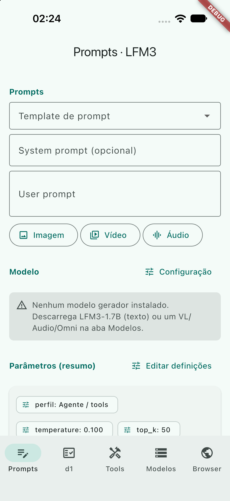

# offline-ai-mobile · Liquid AI LFM3 + d1

App **offline** de laboratório para a suíte móvel da Liquid AI:

- **LFM3-1.7B** — texto, raciocínio `<think>`, agentes e
  **Deferred Tool Search** (`search_tools` → `<additional_tools>`);
- **LFM3-VL-2B** — visão nativa, OCR, pointing/grounding e vídeo a 2 fps;
- **LFM3-Audio-2B** — ASR, LiveASR, TTS a 24 kHz e voz-texto entrelaçado;
- **LFM3-Omni-2B** — texto + imagem + vídeo com banda sonora + áudio;
- **d1-2B / d1-Omni-2B** — decisor "System One" com dez primitivas tipadas
  (`noul`, `choice`, `multiple`, `score`, spans, `range`, `box`, `boxes`) num
  único forward pass, **sem gerar tokens**.

Android primeiro; iOS pela mesma camada de domínio Dart. Nenhum peso vem
embutido: a app descarrega bundles multi-ficheiro para a pasta privada,
verifica SHA-256, retoma downloads por HTTP Range e instala atomicamente.

**Filosofia: mais qualidade que performance, mais determinismo que liberdade.**

## Telas

| Tela | O que faz |
| --- | --- |
| **Prompts · LFM3** | banco de testes: system/user prompt, anexos imagem/vídeo/áudio, perfis de amostragem, raciocínio `<think>` separado, métricas, fingerprint e histórico com diff golden |
| **Decisões d1** | templates das dez primitivas, state, anexos, perguntas faladas (d1-Omni), respostas com probabilidades, spans e caixas desenhadas sobre a imagem |
| **LLM + Tools** | agente LFM3 com 50+ ferramentas deferidas, timeline de raciocínio/tool calls/resultados/cortes do LoopGuard e ferramentas descobertas |
| **Modelos LFM3** | perfilador de hardware (Tier 1/2/3), micro-benchmark real, catálogo de 11 bundles, download/verificação/remoção |
| **Browser** | browser embutido controlado por teclas humanas, piloto d1 (System One) e agente LFM3 (tool calling), com gates de injeção/irreversibilidade |



## Arquitetura

```
lib/src/domain/      LlmConfig LFM3, d1 types, templates, media, tool spec
lib/src/guardrails/  LoopGuard — passos, ciclos, SER@4, teto de <think>, search_tools
lib/src/agent/       ChatML LFM3, parser XML, Deferred Tools, ToolLoop
lib/src/engines/     llama.cpp FFI (libllama + libmtmd), d1 ONNX, tokenizer BPE
lib/src/services/    catálogo, downloader Range/SHA, hardware profiler, mídia
lib/src/ui/          5 ecrãs Material 3
tools/               build llama.cpp b12088, release de modelos, dump do manifesto
pesquisas/           dossiê de pesquisa profunda (fontes e contrato d1)
```

### Motores (porquê dois)

- **llama.cpp FFI (b12088+)** — LFM3-1.7B/VL/Audio/Omni com `libmtmd` para
  imagem, vídeo e áudio, `use_mmap` (pesos como páginas de ficheiro, fora da
  RSS da app) e KV cache F16/Q8_0. A arquitetura tri-híbrida do LFM3 só faz
  crescer o KV nas 6 camadas de atenção global: **12,29 KB/token** em FP16 ou
  **6,53 KB/token** em Q8_0.
- **onnxruntime_v2** — d1-2B/d1-Omni-2B ONNX. A via GGUF do llama.cpp
  (`/v1/systemone`) só expõe `noul`/`choice`/`score`; as primitivas tipadas
  (spans, `range`, `box`, `boxes`, `multiple`) exigem os grafos ONNX.

### Perfilador de hardware

`DeviceCapabilityService` lê RAM total/livre, disco, núcleos de performance,
`asimddp`/`i8mm` e GPU através de `MethodChannel('offline_ai_mobile/hardware')`
(Kotlin/Swift). Classifica o telemóvel em Tier 1 (4 GB), Tier 2 (6 GB) ou
Tier 3 (8 GB+) e constrói a matriz de compatibilidade. O micro-benchmark mede
prefill/decode reais e ajusta o contexto/`image_max_tokens`/raciocínio.

## Modelos e licença

O catálogo aponta para o espelho
[`lfm3-mobile-models`](https://github.com/frederico-kluser/lfm3-mobile-models)
(release `models-lfm3-suite-v1`, manifesto + SHA-256) e, em fallback, para o
Hugging Face oficial:

| Bundle | Tamanho | Uso |
| --- | --- | --- |
| LFM3-1.7B QAD-Q4_0 | 1,05 GB | agente, tools, raciocínio |
| LFM3-1.7B Q4_K_M / Q8_0 | 1,10 / 1,85 GB | qualidade extra |
| LFM3-VL-2B Q4_K_M + mmproj Q8_0 | 1,30 GB | visão/vídeo |
| LFM3-Audio-2B Q4_K_M + mmproj Q8_0 | 1,40 GB | ASR/TTS |
| LFM3-Omni-2B Q4_K_M + mmproj Q4_K_M | 1,39 GB | omni |
| d1-2B Q4_K_M + mmproj Q8_0 | 1,30 GB | d1 GGUF (3 primitivas) |
| d1-Omni-2B Q8_0 + mmproj Q8_0 | 2,17 GB | d1 áudio GGUF |
| d1-2B-ONNX q4f16 | 1,94 GB | d1 completo |
| d1-Omni-2B-ONNX q4f16 | 2,45 GB | d1 completo + áudio |

**Código:** MIT. **Pesos:** [LFM Open License v1.0](https://huggingface.co/LiquidAI/LFM3-1.7B/blob/main/LICENSE)
— Apache-2.0-like, com patentes, mas o §5 limita o uso comercial a
organizações cujo grupo tenha receita anual **< 10 000 000 USD**; acima disso
é necessária licença comercial da Liquid AI. O `d1-omni-600M` é **LFM2
legado**, não LFM3; serve apenas de fallback de baixa RAM.

## Build

```bash
# 1. llama.cpp b12088 com libmtmd (Android; NDK 27.2 + CMake 3.22.1)
bash tools/llama_build.sh

# 2. iOS (Xcode 27+; gera llama.xcframework com llama+mtmd)
bash tools/llama_build_ios.sh

# 3. Patch AGP 9 do flutter_inappwebview (uma vez por máquina)
bash tools/patch_inappwebview_agp9.sh

# 4. App
flutter build apk --release
# ou: flutter build ios --no-codesign / --simulator
```

Requisitos: Flutter 3.47+, Android SDK 36/NDK 27.2, Xcode 27+.

## Testes

```bash
flutter analyze
flutter test                 # 69 testes de domínio, parser, guardrails, d1, download, hardware, UI
flutter test integration_test -d <device>   # CT-01..CT-12 + hardware (SKIP sem modelos)
```

Os cenários CT-01..CT-12 estão em
[`integration_test/lfm3_e2e_test.dart`](integration_test/lfm3_e2e_test.dart) e
em [`docs/ct-scenarios.md`](docs/ct-scenarios.md).

## Limitações honestas

- O pipeline ONNX de mídia do d1 (imagem/áudio) exige o processor oficial; a
  app já aceita o anexo e mostra um erro explícito enquanto esse caminho não
  está ligado. O d1 de **texto** funciona com o contrato de slots/spans.
- A extração de vídeo usa o canal nativo para frames a 2 fps; a banda sonora
  do vídeo ainda não é extraída no dispositivo (o LFM3-Omni precisa dela).
- O espelho GitHub publica **todos os GGUF/mmproj** e o manifesto/SHA-256;
  os subgrafos ONNX do d1 são servidos pelo Hugging Face oficial.
- Não há pesos no git: são sempre descarregados e verificados.

## Documentação

- [`docs/lfm3-migration.md`](docs/lfm3-migration.md) — decisões da migração.
- [`docs/d1-onnx-contract.md`](docs/d1-onnx-contract.md) — prompt, tensores e
  pós-processamento do d1.
- [`docs/ct-scenarios.md`](docs/ct-scenarios.md) — matriz CT-01..CT-12.
- [`tools/llama_ffi.md`](tools/llama_ffi.md) — layout das structs e build.
- [`pesquisas/`](pesquisas/) — dossiê de pesquisa com fontes.
